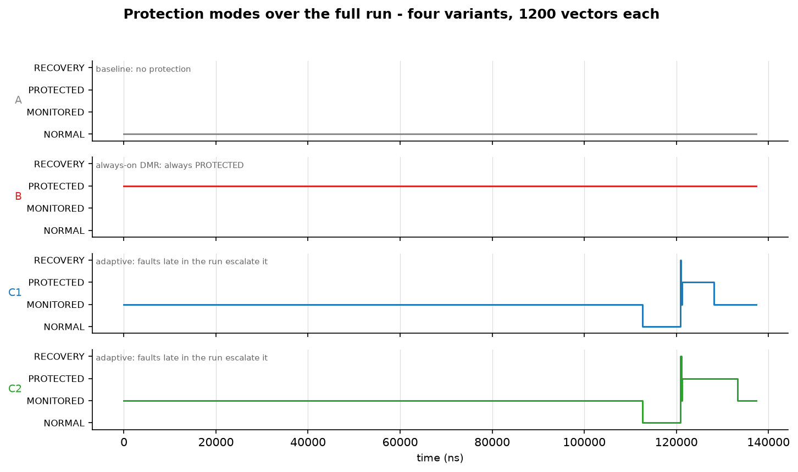
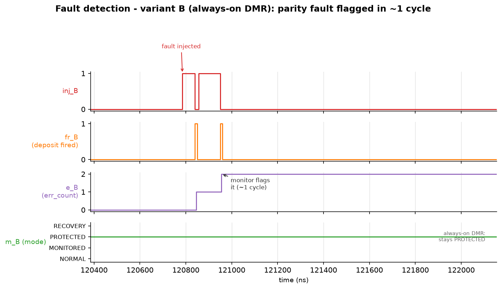
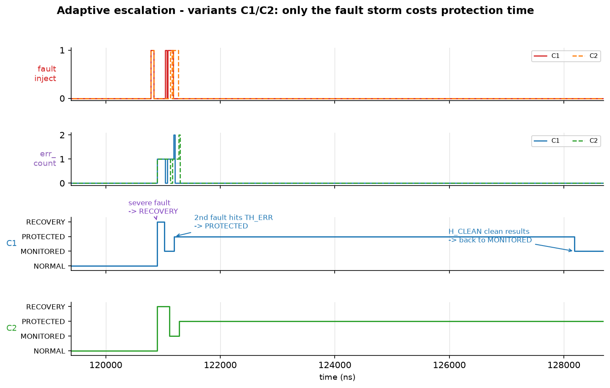

# Runtime-Adaptive Reliability-Aware AI Accelerator (FPGA)

An INT8 dot-product AI accelerator with a runtime-adaptive reliability
subsystem, implemented in synthesizable SystemVerilog and evaluated on
AMD/Xilinx Artix-7 (`xc7a35ticsg324-1L`) with Vivado 2025.2.

One parameterized RTL builds four variants that are compared apples-to-apples:

| Variant | Protection | Correction strategy |
|---------|------------|---------------------|
| **A** | none (baseline) | none — the "0% protection cost" reference |
| **B** | always-on DMR | spatial: second MAC lane compares every result |
| **C1** | adaptive DMR | spatial, escalated only when faults strike |
| **C2** | adaptive temporal | recomputes the vector from an operand checkpoint |

## Block architecture

```
                         in_a/in_b (DATA_W each)
                               │ in_valid
                    ┌──────────▼──────────┐
                    │    input_buffer     │  FIFO, depth 16, stores {a,b}
                    └──────────┬──────────┘
                               │ rd_valid
                    ┌──────────▼──────────────────────────────────────────┐
                    │  accelerator_core                                   │
                    │  ┌─────────────┐   ┌─────────────┐  (lane A always) │
                    │  │  mac_unit   │   │ mac_unit B  │  ← HAS_DMR: B/C1 │
                    │  │  (lane A)   │   │ (lane B)    │    gated by      │
                    │  └──────┬──────┘   └──────┬──────┘    prot_en (C1)  │
                    │   acc ──┤   compare at commit (dmr_match)            │
                    │  ┌──────▼──────────────┐                            │
                    │  │ operand checkpoint  │  vec_a[], vec_b[] (FF array)│
                    │  │ + temporal recompute│  ← HAS_TEMPORAL: C2         │
                    │  └─────────────────────┘                            │
                    │  FSM {IDLE,RUN,SHADOW,COMMIT,WAIT_OUT,REPLAY}       │
                    │  taps: acc, state, busy, result                     │
                    └──────┬──────────────────────────────────────────────┘
                           │ committed result
                    ┌──────▼──────────┐
                    │  output_buffer  │  ── out_result/out_valid/commit
                    └─────────────────┘
   ─────────────────────────── reliability subsystem ───────────────────────
   taps: acc, acc_parity, result, core_state, busy
        ┌───────────────────────┐   ┌──────────────┐   ┌───────────────────┐
        │ reliability_monitor   │──▶│ error_counter │──▶│adaptive_controller│
        │ coarse: range         │   │ count vs      │   │ FSM: NORMAL /     │
        │ fine: +parity+fsm+wd  │   │ TH_ERR/TH_SEV │   │ MONITORED/        │
        │ err_class[1:0]        │   └──────────────┘   │ PROTECTED/RECOVERY│
        └───────────────────────┘                      └─────┬─────────────┘
        ┌───────────────────────┐                            │ prot_en,
        │ fault_detector        │◀── dmr_match/temporal_match│ monitor_fine,
        │ detected/severe/class │───────────────────────────▶│ recovery_req
        └───────────────────────┘   ┌──────────────────┐     │ mode[1:0]
                                    │recovery_controller│◀────┘
                                    │ replay, attempts, │──▶ commit_block
                                    └──────────────────┘
```

Closed loop: `reliability_monitor → error_counter (TH_ERR/TH_SEV + hysteresis)
→ adaptive_controller FSM → protection escalation`. The FSM de-escalates after
`H_CLEAN` clean results and goes quiet after `N_QUIET` — protection costs
nothing while no faults are seen.

## Results (measured)

### Fault-injection campaign — 80,000 injections

`run_fi.ps1`, 1000 injections per (cfg, class, seed), seeds 1–5,
4 fault classes × 4 variants × 5000 = 80,000 total.

| cfg | class | injections | MT-01 % | wrong committed | masked | avg det_lat | avg rec_lat |
|-----|-------|-----------|---------|-----------------|--------|-------------|-------------|
| A  | F-01 acc flip | 5000 | **0.0** | 5000 | 0 | – | – |
| A  | F-02 obuf flip | 5000 | **0.0** | 5000 | 0 | – | – |
| A  | F-03 storage flip | 5000 | **0.0** | 4959 | 41 | – | – |
| A  | F-04 FSM force | 5000 | **0.0** | 2794 | 340 | – | – |
| B  | F-01 acc flip | 5000 | **100.0** | 0 | 0 | 1 | 19.6 |
| B  | F-02 obuf flip | 5000 | 0.0 | 5000 | 0 | 1 | 0 |
| B  | F-03 storage flip | 5000 | 0.0 | 0 | 5000 | – | – |
| B  | F-04 FSM force | 5000 | 32.2 | 4214 | 570 | 106.3 | 14 |
| C1 | F-01 acc flip | 5000 | **100.0** | 2672 | 0 | 1 | 19.1 |
| C1 | F-02 obuf flip | 5000 | 0.0 | 5000 | 0 | 1 | 0 |
| C1 | F-03 storage flip | 5000 | 0.0 | 0 | 5000 | – | – |
| C1 | F-04 FSM force | 5000 | 24.9 | 4214 | 570 | 134.4 | 14 |
| C2 | F-01 acc flip | 5000 | **100.0** | 2697 | 0 | 1 | 28 |
| C2 | F-02 obuf flip | 5000 | 0.0 | 5000 | 0 | 1 | 0 |
| C2 | F-03 storage flip | 5000 | 0.0 | 0 | 5000 | – | – |
| C2 | F-04 FSM force | 5000 | 33.9 | 4198 | 582 | 98.3 | 23 |

- **MT-01** = % of injections flagged by the monitor *before* a wrong result
  was delivered (the headline metric).
- **Headline:** arithmetic faults (F-01) are flagged before a wrong result
  **0.0% of the time unprotected (A) vs 100.0% with protection (B/C1/C2)**
  at ~1 cycle average detection latency.
- Class map: F-01 = MAC result flip, F-02 = output-buffer flip,
  F-03 = storage/register flip, F-04 = FSM state force.
- Full per-seed data: [`reports/fi_results.md`](reports/fi_results.md),
  raw: [`reports/fi_raw.csv`](reports/fi_raw.csv).
- Honest caveat: F-02/F-04 include masked faults and non-trivial detection
  latency; C1/C2 detect but do not prevent every small arithmetic fault.
  See `docs/final_report.md` §5.3.

### Timing & area — 75 MHz signoff (post-route)

| variant | LUT | FF | WNS (ns) | TNS (ns) | Fmax (MHz) | LUT overhead vs A |
|---------|-----|----|----------|----------|-----------|-------------------|
| A | 291 | 480 | **+0.166** | 0 | 75.9 | — |
| B | 582 | 643 | **+0.067** | 0 | 75.4 | +100% |
| C1 | 621 | 655 | **+0.017** | 0 | 75.1 | +113% |
| C2 | 532 | 662 | **+0.066** | 0 | 75.4 | +83% |

All four variants close timing at 75 MHz with zero TNS. The 100 MHz
characterization **fails** and is reported honestly with per-path root cause
(`docs/final_report.md` §6–7).

Throughput (committed results per 1000 cycles): **90.9 / 90.9 / 90.8 / 87.4**
(A/B/C1/C2).

### Power — 75 MHz, SAIF-annotated (post-route)

| variant | dynamic (mW) | static (mW) | total (mW) | overhead vs A | SAIF coverage |
|---------|--------------|-------------|------------|---------------|---------------|
| A | 33 | 60 | **93** | — | 12% (130/1050) |
| B | 38 | 60 | **99** | +6.5% | 7% (132/1826) |
| C1 | 38 | 60 | **98** | +5.4% | 7% (141/1884) |
| C2 | 35 | 60 | **96** | +3.2% | 11% (173/1621) |

Protection overhead is **single-digit percent** on total power; annotation
coverage is disclosed (7–12% of nets) — see `docs/experiment_plan.md`.

### Waveforms







Regenerate the images from a fresh simulation run:

```powershell
powershell -ExecutionPolicy Bypass -File sim\run_sim.ps1 -Tb tb_top_module -Dump   # writes build\tb_top_module.vcd
python tools\plot_waveforms.py                                                        # renders docs\img\*.png
```

## Repository layout

```
rtl/      14 SystemVerilog modules (datapath + reliability subsystem + 4 wrappers)
tb/       9 testbenches: golden system test, unit tests, fault-injection campaign
sim/      Tcl/PowerShell flows + XDC constraints (100 MHz characterization, 75 MHz signoff)
tools/    waveform plotter: VCD → PNG screenshots for this README
docs/     requirements, architecture, verification plan, experiment plan, final report
reports/  measured evidence: synthesis/timing, fault injection, power (CSV + Vivado RPT)
```

## Reproducing

Requires Vivado 2025.2 (Windows). From the `sim\` folder:

```powershell
powershell -ExecutionPolicy Bypass -File run_synth.ps1     # synth + impl, timing CSVs
powershell -ExecutionPolicy Bypass -File run_sim.ps1 -Tb tb_top_module   # golden test
powershell -ExecutionPolicy Bypass -File run_fi.ps1        # fault-injection campaign
powershell -ExecutionPolicy Bypass -File run_power.ps1     # power reports
```

The scripts stage sources to a space-free temp directory before invoking
Vivado (the containing folder path may contain spaces).

## Documentation

- `docs/final_report.md` — full results, deviations, limitations, repro commands
- `docs/requirements_spec.md` — requirements (F/MT/N/V numbering used throughout)
- `docs/verification_plan.md` — testbench strategy and assertions (N-07 amendment)
- `docs/experiment_plan.md` — measurement methodology and threats to validity
- `docs/architecture.md` — block diagram, parameter table, interface specs

## Scope and limitations (short version)

RTL-level fault model (not bitstream SEUs), simulation-only verification,
single clock domain, partial SAIF annotation, and C1/C2 detect-but-do-not-
prevent every small arithmetic fault. Full discussion with numbers:
`docs/final_report.md` sections 5.3 and 12.
